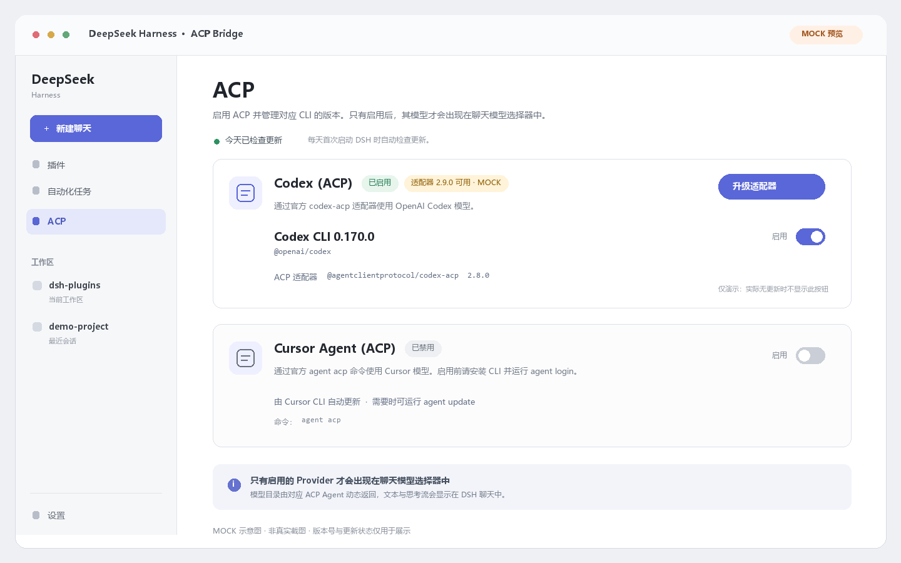

# DSH ACP Bridge

把 **OpenAI Codex**、**Cursor Agent** 以及其他兼容 [Agent Client Protocol (ACP)](https://agentclientprotocol.com/) 的 Agent 接入 DeepSeek Harness，作为聊天模型 Provider 使用。

插件在 DSH 左侧增加 **ACP** 管理页：统一控制 Provider 开关、查看 CLI 与适配器版本、检查更新，并从聊天模型选择器直接使用外部 Agent 的模型。

## 效果预览



> 上图是 **MOCK 示意图，不是实际截图**。版本号和更新状态仅用于展示界面；实际模型、版本和升级按钮以你的环境为准。

## 功能一览

- **ACP 侧边栏管理**：列出内置和自定义 Provider，每个 Provider 都有独立开关。
- **启用后才显示模型**：关闭 Provider 后，其模型会从聊天模型选择器中移除，相关 ACP 子进程随配置重载回收。
- **内置 Codex**：使用官方 `codex-acp` 适配器，复用本机 Codex 登录状态，无需重复安装适配器。
- **内置 Cursor Agent**：通过官方 `agent acp` 启动，安装并登录 Cursor CLI 后即可启用。
- **版本分开显示**：OpenAI Codex CLI 版本与 `codex-acp` 适配器版本不再混为一谈。
- **每日更新检查**：每天首次启动 DSH 时检查 Codex ACP 适配器更新；只有发现新版本才显示升级按钮。
- **动态模型目录**：展示 Agent 实际返回的模型与推理级别，支持模型切换、文本/思考流、取消和进程回收。
- **自定义 ACP Agent**：可以接入其他命令行 ACP 服务，并按需声明静态模型列表。

## 安装插件

### 方式一：在 DSH 中安装

1. 打开 **Plugins** 页面。
2. 点击 **Add plugin**。
3. 输入本仓库的 Git 地址，或插件在本机的绝对目录。
4. 安装完成后启用 `@local/dsh-acp-bridge`。

### 方式二：本地开发安装

```bash
git clone <你的 GitHub 仓库地址>
cd dsh-acp-bridge
pnpm install --ignore-scripts
```

然后在 **Plugins → Add plugin** 中填写这个目录的绝对路径。开发环境需要 **Node.js 22+**；当前插件面向 **DSH 0.2.2-rc.5**。

安装并启用后，DSH 左侧导航会出现 **ACP** 入口。

## 使用 Codex

### 1. 登录 Codex

插件依赖中已包含 `codex-acp` 和兼容的 `@openai/codex`，不需要再全局安装适配器。确认本机 Codex 已登录：

```bash
codex login status
```

如果尚未登录，先运行：

```bash
codex login
```

插件默认使用本机 `~/.codex` 中的登录信息。需要指定另一个 Codex 可执行文件时，可在 Provider 的 `env` 中设置 `CODEX_PATH`。

### 2. 启用并选择模型

1. 打开左侧 **ACP**。
2. 确认 **Codex (ACP)** 已启用；默认就是启用状态。
3. 新建或打开聊天。
4. 在模型选择器中展开 **Codex (ACP)**，选择由 ACP 动态发现的模型。
5. 发送消息后，外部 Agent 的文本和思考会流式显示在 DSH 聊天中。

## 使用 Cursor Agent

### 1. 安装并登录 Cursor CLI

按照 [Cursor CLI 官方安装文档](https://cursor.com/docs/cli/installation) 安装独立 CLI。Windows PowerShell 安装命令为：

```powershell
irm 'https://cursor.com/install?win32=true' | iex
```

验证安装并登录：

```powershell
agent --version
agent login
```

也可以通过启动 DSH 的环境提供 `CURSOR_API_KEY` 或 `CURSOR_AUTH_TOKEN`。这些变量只会传给 Cursor Provider，不会转发给 Codex 或其他自定义 Agent。

### 2. 启用并选择模型

1. 打开左侧 **ACP**。
2. 找到 **Cursor Agent (ACP)**；它默认关闭。
3. 打开开关，等待 Provider 注册。
4. 在聊天模型选择器中选择 Cursor Agent 提供的模型。

插件通过官方 [`agent acp`](https://cursor.com/docs/cli/acp) 命令启动 Cursor ACP 服务。

## ACP 管理页与更新效果

### 开关如何影响模型选择器

- **开启**：注册 Provider，模型选择器可以列出并解析它提供的模型。
- **关闭**：注销 Provider，模型选择器不再显示其模型，已有 ACP 进程会被回收。
- **重新开启**：无需重新安装插件，Provider 会重新注册。

### Codex 的两个版本号

Codex 卡片会分别显示：

```text
Codex CLI 0.170.0
@openai/codex

ACP 适配器 @agentclientprotocol/codex-acp 2.8.0
```

- **Codex CLI 版本**：从当前选中的适配器实际解析出的 `@openai/codex` 依赖获得。
- **ACP 适配器版本**：`@agentclientprotocol/codex-acp` 自身的版本。
- **升级适配器**：升级 `codex-acp` 及其声明的兼容 Codex CLI 依赖，不是把适配器版本当成 OpenAI Codex 版本。

### 更新规则

| Provider | 更新方式 |
| --- | --- |
| Codex | 每天首次启动 DSH 检查 `codex-acp` 适配器；发现新版本时显示 **升级适配器**。安装成功后重启 DSH 生效。 |
| Cursor Agent | Cursor CLI 默认自动更新，也可手动运行 `agent update`。 |
| 自定义外部 CLI | 由对应 CLI 自己管理；声明了可托管 npm 包的 Provider 可使用插件更新机制。 |

Codex 更新状态和版本选择保存在：

```text
$DSH_HOME/cache/acp-bridge/
```

同一天重复启动、刷新页面或切换开关不会重复检查。更新安装到按 Provider 和版本隔离的目录，不修改插件包或 DSH Profile 的依赖清单，也不会覆盖正在运行的版本。安装失败会继续使用旧版本并显示错误。

## 会话行为与限制

ACP 暴露的是完整 Agent 会话，而不是原始 LLM 补全接口：

- 每次 DSH 模型请求创建独立 ACP 会话，以 DSH 日志中的系统提示和消息历史为准。
- 支持动态模型目录、模型切换、推理级别切换、文本/思考流、取消和进程回收。
- **DSH 工具定义不会成为外部 Agent 的可调用工具。** 历史 DSH 工具调用和结果仅以纯文本进入上下文。
- 外部 Agent 使用自己的工具，其执行过程不会映射为 DSH 工具调用事件。
- 当前桥接以文本为主，不转发图片或音频，也不上报 token 用量。
- 内置 Codex 默认 `INITIAL_AGENT_MODE=read-only`；其他 Agent 的初始模式由其自身决定。
- 所有 Provider 默认 `permission: reject`。只有显式设置为 `allow` 才会自动批准权限请求，请先理解自动批准的风险。
- 模型目录按 ACP 实际返回值展示，不做 GPT 名称过滤。

## 配置

通常直接使用 ACP 管理页即可。高级配置请放在自己的 Cordis 配置覆盖层中，不要修改插件包内的 `cordis.patch.yml`。

### 常用配置示例

```yaml
- id: acp-bridge
  name: '@local/dsh-acp-bridge'
  config:
    providers:
      codex:
        displayName: Codex (ACP)
        enabled: true
        permission: reject
      cursor:
        displayName: Cursor Agent (ACP)
        enabled: false
        command: agent
        args: [acp]
        permission: reject
```

已有配置缺少 `cursor` 时，插件会自动补入默认关闭的 Cursor Agent。自定义 Provider 映射不会自动恢复已移除的 Codex；仍需 Codex 时请保留 `codex` 条目。

### Provider 字段

| 字段 | 默认值 | 说明 |
| --- | --- | --- |
| `displayName` | 按 Provider 推导 | 管理页和模型选择器中的名称。 |
| `enabled` | Codex 为 `true`，Cursor 为 `false` | 是否注册该 Provider。 |
| `command` | Codex 为空，Cursor 为 `agent` | ACP 命令；空命令使用内置或托管包。 |
| `args` | Codex 为 `[]`，Cursor 为 `[acp]` | 直接传递给命令的参数，不经过 shell。 |
| `packageName` | Codex 为 `@agentclientprotocol/codex-acp` | 空 `command` 时使用的托管 ACP 包。 |
| `env` | `{}` | 显式环境变量覆盖层，不建议写入明文密钥。 |
| `cwd` | 空 | 空值使用当前 DSH 会话工作目录。 |
| `permission` | `reject` | `reject` 或 `allow`。 |
| `startupTimeoutMs` | `90000` | ACP 启动和建会话超时。 |
| `modelCacheMs` | `60000` | 动态模型目录缓存时间；`0` 表示每次重新发现。 |
| `allowImplicitModel` | `false` | Agent 无模型选择能力时，是否信任启动命令已选定模型。 |
| `models` | `[]` | 静态模型列表；为空时通过 ACP 动态发现。 |

### 接入其他 ACP Agent

```yaml
providers:
  another-agent:
    displayName: Another Agent (ACP)
    enabled: true
    command: /absolute/path/to/acp-agent
    args: []
    env: {}
    permission: reject
    models: []
```

每个 Provider 使用一个长期复用的 ACP 进程，模型请求使用独立会话。

### 使用静态模型列表

动态发现不可用或需要固定目录时，可以声明模型：

```yaml
providers:
  codex:
    models:
      - id: your-model-id
        name: Your model name
        contextWindow: 258400
        maxTokens: 32768
        reasoningEfforts: [low, medium, high]
```

请将 ID 和能力字段替换为 Agent 实际支持的值。静态列表不会在保存时做在线校验；发送请求时，如果 Agent 暴露模型选择器，插件仍会校验并切换模型。

## 故障排查

### 模型发现失败

依次检查命令是否存在、账号是否登录、网络和服务商是否可用：

```bash
# Codex
codex login status
codex doctor --summary

# Cursor Agent
agent status
agent about
agent models
```

冷启动较慢时可以增大 `startupTimeoutMs`。插件不会把 ACP 子进程的原始 stderr 写入模型错误，避免账号或配置细节进入聊天。

### 启用后模型选择器没有对应 Provider

- 确认 ACP 管理页中的开关已经打开。
- 查看该 Provider 的模型发现是否报错。
- 检查外部 Agent 是否已登录并能访问模型服务。
- 如需跳过在线目录发现，可配置静态 `models`；实际请求仍要求 Agent 能创建会话。

## 开发验证

```bash
pnpm install --ignore-scripts
pnpm run check
pnpm test
```

执行一次真实的 Codex 短请求：

```bash
pnpm run probe:codex
```

仅检查模型目录：

```bash
ACP_PROBE_MODELS_ONLY=1 pnpm run probe:codex
```

Windows PowerShell 使用 `$env:ACP_PROBE_MODELS_ONLY='1'`。也可通过 `ACP_PROBE_MODEL` 指定模型，通过 `ACP_PROBE_STARTUP_MS` 调整启动等待时间。

## License

[MIT](LICENSE)
